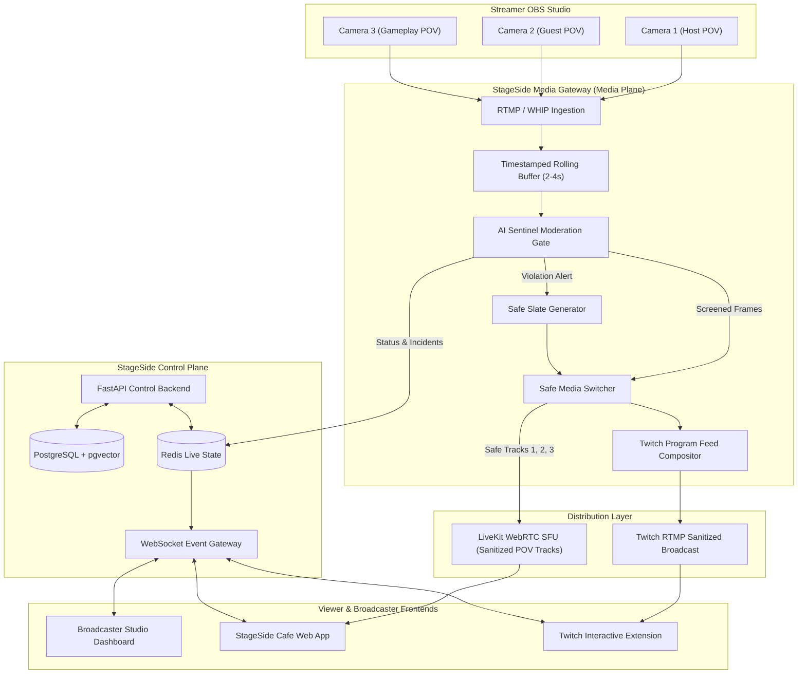

# StageSide Cafe

> **Every angle. Your community. One safer streaming experience.**

StageSide Cafe is an AI-first livestreaming platform that turns traditional Twitch broadcasts into personalized, multi-camera viewing experiences with AI-organized communities and preventative, automated content protection.

---

## 🌟 Core Pillars

1. **POV Switchboard**: Viewers independently switch between Host, Guest, Gameplay, and secondary camera feeds without reloading or interrupting other viewers.
2. **AI Sentinel**: An in-line media gateway rolling-buffer that screens sampled frames *before* they are delivered to Twitch or LiveKit. When unsafe content is detected, the affected camera is instantly cut and substituted with a safe fallback slate without terminating the broadcast or affecting other feeds.
3. **StageSide Cafe Communities**: Viewers are clustered into small, high-engagement cafe rooms of 3–6 people using pgvector interest embeddings, complete with real-time chat, synced POV notifications, and icebreakers.

---

## 🏛️ System Architecture



---

## 🚀 Quick Start

### Scripted terminal walkthrough

From the repository root, run:

```bash
python3 scripts/demo_simulation.py
```

This prints a scripted multi-POV and AI Sentinel story. It does not start the services or connect a live camera.

### Browser demo on your computer

Prerequisites for the browser and Twitch demo: Node.js 18+ and Python 3.10+. The demo uses local SQLite and does not require Docker. Docker Compose can start the optional PostgreSQL, Redis, and LiveKit services; FFmpeg and GStreamer are only needed for the media gateway.

Copy the environment template:

```bash
cp .env.example .env
```

For Twitch sign-in, create a Twitch Developer app, add its Client ID and Secret to .env, and register this exact callback URL:

```text
http://localhost:8000/api/v1/auth/twitch/callback
```

Install dependencies. The local Twitch demo uses SQLite from `.env`, so Docker is optional; start the infrastructure containers only when you need Redis, LiveKit, or the full stack:

```bash
make setup
# Optional: start PostgreSQL, Redis, and LiveKit
make docker-up
```

Start the API and web app in separate terminals:

```bash
make dev-api
```

```bash
make dev-web
```

Open [http://localhost:5173](http://localhost:5173), select **Connect Twitch**, authorize the account, then open **Studio Mode** to see the connected channel and its live status.

To show the moderation service, also run **make dev-moderation** in another terminal. The media gateway is optional for the UI demo; real camera feeds require its dependencies and an OBS feed, so start it with **make dev-gateway** only when those are configured.

### Render demo deployment

The Render Blueprint runs the React app and FastAPI together in one web service, with a managed Postgres database for connected Twitch accounts. It uses in-memory Redis for the demo profile. It demonstrates the hosted app and Twitch OAuth/channel status; it does not host the multi-camera media pipeline, LiveKit, moderation service, or media gateway.

1. Push this repository to a Git provider connected to Render.
2. In the Render Dashboard, choose **New → Blueprint**, select the repository, and apply the Blueprint from the root `render.yaml`. Render creates the free web service and free Postgres database.
3. During Blueprint setup, provide `TWITCH_CLIENT_ID` and `TWITCH_CLIENT_SECRET` from your Twitch Developer application.
4. After the service deploys, copy its `https://<service-name>.onrender.com` URL. In the Twitch Developer Console, add this callback URL to the app's OAuth Redirect URLs:

```text
https://<service-name>.onrender.com/api/v1/auth/twitch/callback
```

The app derives this callback from Render's `RENDER_EXTERNAL_URL`; you do not need to set `TWITCH_REDIRECT_URI` manually. The callback must exactly match the URL registered with Twitch. The Blueprint sets `WEB_APP_URL` and `CORS_ORIGINS` from the generated Render service URL.

5. Open the Render service URL and select **Connect Twitch**. If you add or change Twitch credentials after Blueprint setup, save the environment variables and redeploy the web service.
6. Keep the generated `APP_SECRET_KEY` value stable; it encrypts stored Twitch tokens. The Render free web service has an ephemeral filesystem, so the Blueprint stores account data in Postgres rather than a local SQLite file.

Render's free web service spins down after 15 minutes without traffic and can take about a minute to wake up. Free Postgres is limited to 1 GB and expires after 30 days, so this setup is for a temporary demo; upgrade the database for longer-lived hosting. See [Render free instance limits](https://render.com/docs/free), [Blueprint configuration](https://render.com/docs/blueprint-spec), and [Render environment variables](https://render.com/docs/environment-variables).

## 📡 Key API Endpoints

| Method | Endpoint | Description |
|---|---|---|
| `GET` | `/api/v1/auth/twitch/login` | Twitch OAuth authorization URL |
| `GET` | `/api/v1/twitch/account` | Connected Twitch identity and live channel status |
| `POST` | `/api/v1/streams` | Create a new stream session |
| `POST` | `/api/v1/streams/{id}/cameras` | Register a multi-POV camera feed |
| `GET` | `/api/v1/streams/{id}/cameras` | Get list of available safe camera POVs |
| `POST` | `/api/v1/cameras/{id}/restore` | Manually restore isolated camera feed |
| `POST` | `/api/v1/communities/join` | Join an AI-matched Cafe community room |
| `POST` | `/api/v1/viewers/select-camera` | Change viewer's selected POV track |
| `POST` | `/api/v1/streams/{id}/emergency-lock` | Panic button: immediate broadcast cut |
| `WS` | `/ws/streams/{id}` | Real-time WebSocket event connection |

---

## 🛡️ License
Distributed under the Apache 2.0 License. See `LICENSE` for details.
