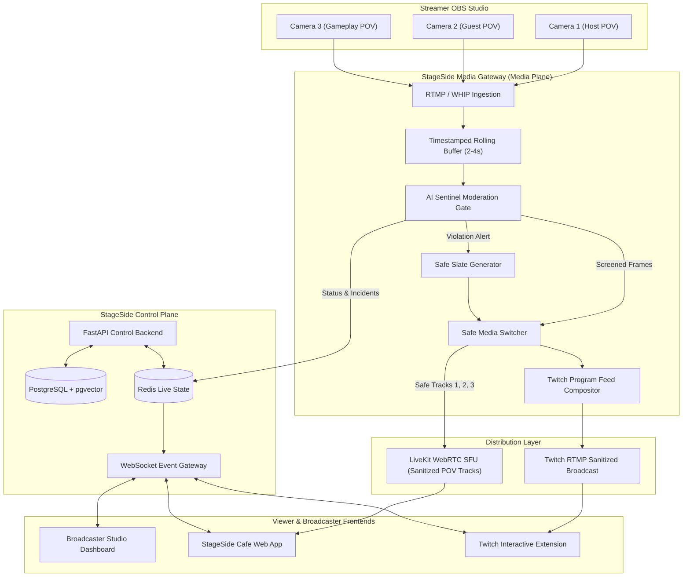

# StageSide Cafe

> **Every angle. Your community. One safer streaming experience.**

StageSide Cafe is an AI-first livestreaming platform that turns traditional Twitch broadcasts into personalized, multi-camera viewing experiences with AI-organized communities and preventative, automated content protection.

---

## 🌟 Core Pillars

1. **POV Switchboard**: Viewers independently switch between Host, Guest, Gameplay, and secondary camera feeds without reloading or interrupting other viewers.
2. **AI Sentinel**: An in-line media gateway rolling-buffer that screens sampled frames *before* they are delivered to Twitch or LiveKit. When unsafe content is detected, the affected camera is instantly cut and substituted with a safe fallback slate without terminating the broadcast or affecting other feeds.
3. **StageSide Cafe Communities**: Viewers are clustered into small, high-engagement cafe rooms of 3–6 people using pgvector interest embeddings, complete with real-time chat, synced POV notifications, and icebreakers.

---

## 🏛️ System Architecture



---

## 🚀 Quick Start

### 1. Prerequisites
- **Node.js**: v18+ (Node 22 recommended)
- **Python**: 3.10+
- **Docker & Docker Compose** (for PostgreSQL + pgvector, Redis, and LiveKit SFU)
- **FFmpeg & GStreamer**

### 2. Environment Setup
```bash
cp .env.example .env
```

### 3. Start Infrastructure
```bash
docker compose up -d postgres redis livekit
```

### 4. Start Services
- **Backend API**:
  ```bash
  cd services/api
  uvicorn app.main:app --reload --port 8000
  ```
- **AI Sentinel Moderation API**:
  ```bash
  cd services/moderation
  uvicorn api:app --reload --port 8001
  ```
- **Media Gateway**:
  ```bash
  cd services/media-gateway
  python3 gateway.py
  ```
- **Web Frontend**:
  ```bash
  cd apps/web
  npm install
  npm run dev
  ```

---

## 📡 Key API Endpoints

| Method | Endpoint | Description |
|---|---|---|
| `GET` | `/api/v1/auth/twitch/login` | Twitch OAuth authorization URL |
| `POST` | `/api/v1/streams` | Create a new stream session |
| `POST` | `/api/v1/streams/{id}/cameras` | Register a multi-POV camera feed |
| `GET` | `/api/v1/streams/{id}/cameras` | Get list of available safe camera POVs |
| `POST` | `/api/v1/cameras/{id}/restore` | Manually restore isolated camera feed |
| `POST` | `/api/v1/communities/join` | Join an AI-matched Cafe community room |
| `POST` | `/api/v1/viewers/select-camera` | Change viewer's selected POV track |
| `POST` | `/api/v1/streams/{id}/emergency-lock` | Panic button: immediate broadcast cut |
| `WS` | `/ws/streams/{id}` | Real-time WebSocket event connection |

---

## 🛡️ License
Distributed under the Apache 2.0 License. See `LICENSE` for details.
